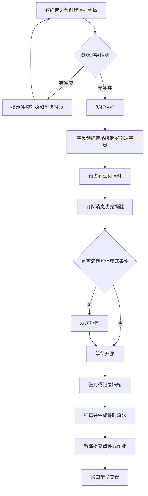
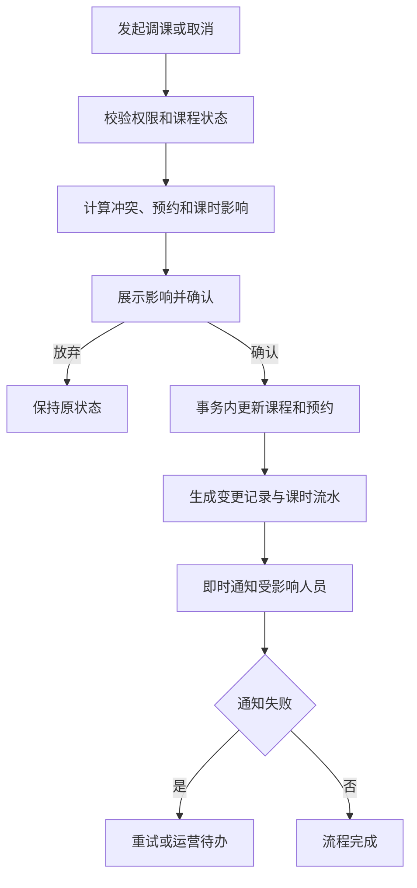
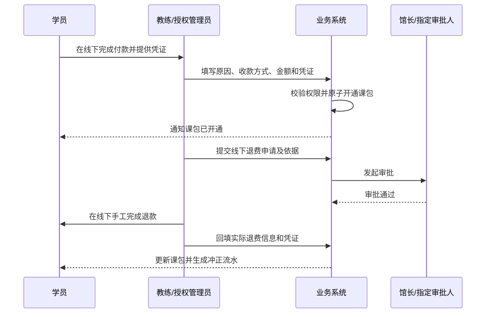
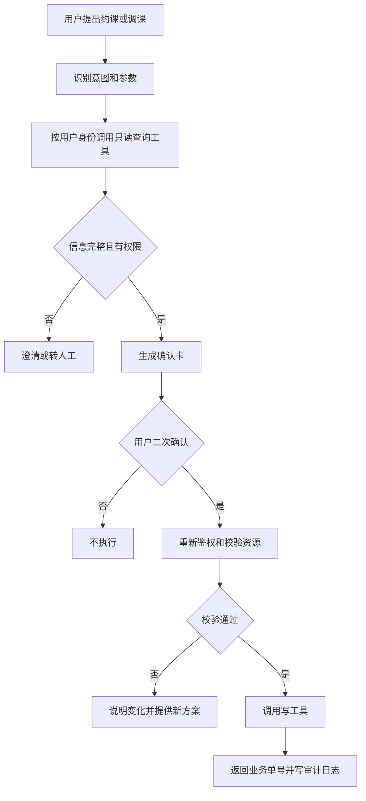
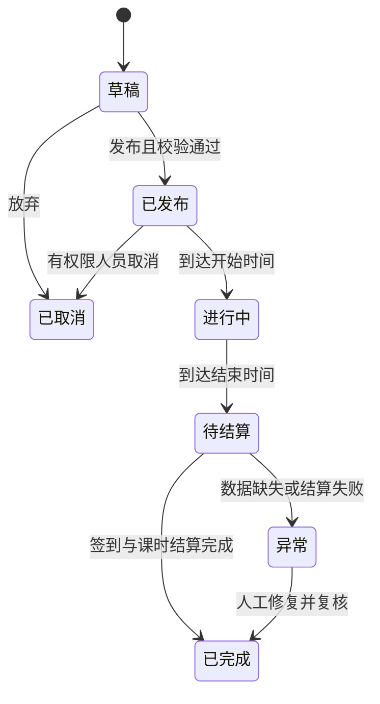
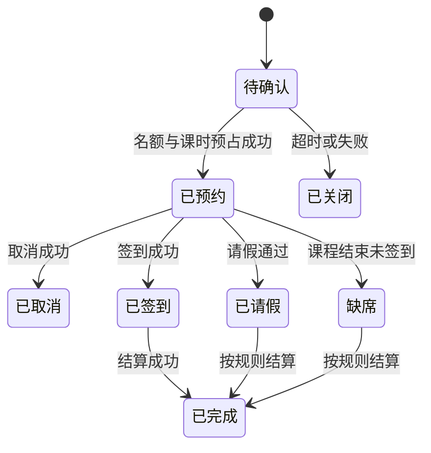

# 羽毛球教学俱乐部线上系统功能需求文档

## 0. 文档信息

- 文档版本：V1.0
- 文档日期：2026-09-24
- 适用地区：中国大陆
- 文档状态：客户评审稿
- 目标读者：俱乐部决策人、馆长、运营、教练、产品、原型、研发、测试和合规评估人员
- 建设终端：微信小程序学员界面、微信小程序教练界面、Web 管理端
- 文档用途：确认业务边界、支撑原型设计、研发拆分和验收
- 需求优先级：
  - P0：首期必须交付。
  - P1：业务闭环增强。
  - P2：教学内容建设。
  - P3：智能化能力。

### 0.1 术语

- 学员：接受培训的人；未成年人可由监护人代管账号。
- 监护人：代未成年学员查看、预约和接收通知的人。
- 教练：负责授课、排课、签到、点评和教学内容维护的人。
- 馆长：负责本俱乐部人员、课程、课包和规则配置的人。
- 运营：经授权处理排课、学员、课包、内容和通知的工作人员。
- 课程类型：私教、小班课、大班课、体验课等课程模板。
- 课程实例：在明确时间、场地和教练下实际发生的一节课。
- 预约：学员占用课程名额并预占课时的记录。
- 课包：学员线下付款后，由教练或授权管理员在 Web 后台手动配置并开通的课时权益。
- 消课：按规则从学员课包中正式扣减课时。
- UGC：学员或教练发布的心得、评论、图片和视频等用户生成内容。
- 订阅消息：用户主动同意后，由微信提供的小程序消息能力。
- 智能体：通过自然语言理解意图，并在授权范围内调用系统工具完成查询或业务操作的 AI 助手。

## 1. 背景、目标与 KPI

### 1.1 业务背景

俱乐部当前可能依赖微信群、电话和 Excel 处理排课、提醒、课时和教学内容。信息分散会导致场地或教练冲突、调课漏通知、课时账目不透明以及视频难沉淀。

系统采用一个微信小程序入口。登录后按当前身份进入学员或教练界面；同时具有多种身份的人可以显式切换。教练还可使用 Web 端进行高效率排课，馆长和运营在 Web 端完成全局管理。

### 1.2 产品目标

1. 建立从排课、预约、提醒、签到到消课的可追溯闭环。
2. 降低人工沟通和冲突处理成本，减少漏课与场地浪费。
3. 沉淀视频、点评、作业和心得，形成连续学习档案。
4. 让课包开通、余额、变动原因和线下退费处理对相关人员透明且可审计。
5. 最终提供面向课程、课时、排课与教学场景的受控、可审计智能体服务。

### 1.3 KPI 建议

基线数据在一期上线前连续采集 4 周，以下目标在正式上线后 3 个月评估：

- 系统排课率：系统内创建的课程实例数 ÷ 全部实际课程数，目标不低于 90%。
- 预约闭环率：完成签到或明确取消的预约数 ÷ 已确认预约数，目标不低于 95%。
- 课程冲突率：发布后因资源冲突而人工改课的课程数 ÷ 已发布课程数，目标低于 1%。
- 学员缺席率：无签到且无有效请假的预约数 ÷ 应到预约数，较基线下降 30%。
- 通知触达率：至少一个有效通道送达的通知数 ÷ 应发通知数，目标不低于 98%。
- 课时账实差异：抽查发现异常的课时流水数 ÷ 抽查流水数，目标低于 0.1%。
- 点评及时率：课后 24 小时内完成点评的已完成课程数 ÷ 要求点评的课程数，目标不低于 80%。
- 二期流程处理及时率：候补递补、请假审批、补课资格生成和课包到期预警在约定时限内完成的比例，目标不低于 95%。
- 三期内容沉淀：活跃学员每月获得或提交的有效视频、点评、作业记录平均不少于 2 条。
- 四期智能体任务完成率：无需人工接管且成功完成的智能体任务数 ÷ 发起任务数，目标不低于 70%；写操作误执行为 0。

## 2. 范围与非范围

### 2.1 产品规划范围（按分期，不是「一期全做」）

**一期 MVP（2026-11-30 验收，见 §5.0 / §5.1）：** 登录与身份、单场馆场地与课程类型、排课（Web 为主；教练端仅本人单次课与可约时段）、约课取消、签到消课、课时流水、课包手工开通、订阅消息与短信、校区出入证、运营工作台、排课中心教练课时与场地占用、学员只读消息列表。

**二期：** 候补、请假补课、课表复制、班级管理、续费预警、消息模板完善。

**三期：** 视频库、课后点评、作业、心得、评论、内容审核、成长档案。

**四期：** 查询/约课/调课/排课草稿等智能体能力。

全期合计仍受 §2.2 非范围约束（无支付、无多门店、无经营报表）。

### 2.2 非范围

- 完整 ERP、会计总账、发票税控和工资发放。
- 专业赛事报名、裁判编排和赛事直播。
- 自营硬件门禁、摄像机或场地灯控；仅预留接口。
- 面向公众的开放社交平台和陌生人私聊。
- AI 自动诊断伤病、替代医生或作出训练安全保证。
- 由 AI 自动开通课包、发起线下退费或修改收款凭证。
- 跨境数据传输方案及境外支付。
- 多门店、跨店人员管理、跨店课包、跨店排课和跨店数据汇总。
- 微信支付、其他在线支付、在线购买课包、支付回调、线上退款和支付对账。
- 经营报表、收入看板、续费率看板、消课金额和其他经营分析能力。

## 3. 用户角色与权限

### 3.1 角色定义

- 学员：查看本人信息、约课、取消、签到、查看课包和学习内容、发布心得。
- 监护人：管理已绑定的未成年学员；每次操作必须明确当前学员。
- 教练：管理本人可用时间和本人课程，查看授权学员信息，签到、点评、上传教学内容；获得课包权限后可在 Web 后台手工开通课包。
- 运营：按授权管理排课、学员、课包、通知和内容，不默认拥有退费审批和权限配置权。
- 馆长：管理本俱乐部的教练、场地、课包授权和线下退费审批。
- 系统管理员：管理租户级账号、角色、权限、系统参数、第三方通道和审计查询。
- 内容审核员：查看待审核内容并执行通过、驳回、下架操作，不可修改课时和财务数据。

### 3.2 权限原则

- 采用“角色权限 + 数据归属”两层控制；系统只承载一个俱乐部和一个场馆。
- 默认拒绝；新增角色或接口必须明确授权后才能访问。
- 教练仅可查看其授课或被分配学员的最小必要档案；仅获授权的教练可查看线下收款记录并开通课包。
- 课包开通、线下退费、赠课、延期和手工改课时等敏感操作须填写原因，并按配置进入审批。
- 用户切换身份后，菜单、数据范围、智能体权限和审计身份同步切换。
- 后台敏感操作记录操作者、时间、对象、变更前后值、原因和来源 IP。

## 4. 三端信息架构

### 4.1 学员界面（微信小程序）

- 登录：微信快捷登录；可绑定手机号（短信核验）。不提供独立传统注册页，也不把短信验证码登录作为小程序主路径。
- 首页：下一节课、校区出入证快捷入口、快捷约课、剩余课时、待完成事项、公告和推荐内容。
- 校区出入证：全屏出示学员身份与动态二维码、有效期与通行时段，供大学校区门岗/闸机核验；入口置于首页醒目位置与「我的」。
- 课表：日历、可约课程、预约详情、取消。请假和候补为二期。
- 学习（三期）：教学视频、课后点评、作业、成长档案和心得广场。
- 消息（一期只读列表）：课程、课包与系统通知；不提供独立上课提醒设置页。
- 我的：学员切换、身份切换、课包与流水、出入证入口、隐私与账号设置。上课提醒不设独立设置页，在约课等场景按微信规则请求订阅消息授权；短信偏好由 Web 消息中心与绑定手机号统一管理。
- AI 助手（四期）：查课、查课时、约课、调课和教学知识问答。

### 4.2 教练界面（同一微信小程序）

- 登录：微信快捷登录；手机号须与后台预登记匹配后绑定教练身份。
- 今日：首页时间线、签到入口、待点评和异常提醒。
- 课表：周视图、本人单次新建、可约时段。周期排课、调课确认在 Web。
- 学员：授权学员、课时预警、训练记录和点评历史。
- 教学（三期）：视频库、作业、点评和内容发布。
- 我的：身份切换、个人资料和本人课时统计。上课提醒不设独立设置页。
- AI 助手（四期）：日程查询、排课草稿、冲突解释和学员预警查询。

### 4.3 Web 应用

- 登录：手机号验证码或账号密码；支持退出、失败锁定策略演示。
- 工作台：今日课程、签到、异常、待办和通知失败。
- 排课中心：日/周/月、教练/场地视图、教练筛选、课次明细（学员名单与时长）、拖拽、周期排课、冲突和发布；附教练课时与场地占用汇总。
- 学员与教练：档案、课包、训练记录、可用时间和导入导出；教练支持预登记手机号、启用/停用、重置密码、Web 账号开通。
- 课包管理：课包方案、线下收款登记、手工开通、线下退费审批、课时流水和操作审计。
- 内容中心（三期）：视频、点评、作业、心得、评论和审核。
- 消息中心：模板、计划、发送记录、失败处理和通道配置。免打扰默认 22:00—08:00，由后台统一，学员端不设开关页。
- 教练课时与场地占用：放在排课中心，不单设数据中心，不包含经营指标。教学统计随三期内容中心。
- 系统设置：场馆信息、场地、课程类型、预约规则、角色权限、审批、第三方通道、隐私、审计和数据保留。班级管理为二期。
- AI 助手（四期）：课程与课时查询、排课草稿、异常解释和教学问答。

## 5. 分阶段路线图与验收条件

周期为建议值，需在客户确认范围、人员投入和第三方审核周期后重新估算。

### 5.0 截止 2026-11-30 的可完成性结论

- **可用日历**：自 2026-09-24 至 2026-11-30，约 **9.5 周 / 47 个工作日**（按每周 5 个工作日粗算）。
- **四期合计**：原估算 **24~32 周**，**无法在 11 月底全部完成**。
- **建议承诺**：该截点仅验收 **一期 MVP**（原估算 8~10 周）；二期及以后顺延。
- **人员假设（一期并行）**：后端 1~2、小程序 1~2、Web 1、测试 1、产品/项目 0.5；合计约 **4.5~6.5 人全职当量**。
- **一期工作量**：约 **90~120 人天**（含联调与一轮验收，不含微信/短信类目与资质的外部等待空窗被拉长的情况）。

| 模块 | 人天 | 说明 |
|------|------|------|
| 账号与角色（微信登录、绑定、身份切换） | 10~14 | 含预登记教练/学员 |
| 场馆场地与课程类型 | 6~8 | 单场馆深职大 |
| 排课中心（单次/周期、冲突） | 16~22 | Web 为主，教练端快速排课 |
| 约课取消与课时流水 | 14~18 | 学员端 + 服务端事务 |
| 签到消课 | 8~10 | 教练点名 |
| 课包手工开通与线下收款登记 | 12~16 | Web + 审计 |
| 订阅消息 + 短信提醒 | 8~12 | 含模板与发送记录；外部审核另计 |
| 校区出入证 | 5~8 | 动态码、有效期跟课包 |
| 基础工作台与权限审计 | 6~8 | |
| 联调、缺陷修复、验收 | 12~16 | |
| **合计** | **90~120** | |

**一期建议日历（倒排至 11-30）：**

| 周次 | 日期（约） | 交付 |
|------|------------|------|
| W1 | 09-24 ~ 09-30 | 范围冻结、环境、账号骨架、场馆主数据 |
| W2~W3 | 10-01 ~ 10-14 | 排课草稿/发布/冲突；学员约课主路径 |
| W4~W5 | 10-15 ~ 10-28 | 签到消课、课时流水、课包开通 |
| W6~W7 | 10-29 ~ 11-11 | 消息提醒、出入证、工作台 |
| W8 | 11-12 ~ 11-18 | 全链路联调、权限与审计补齐 |
| W9~截点 | 11-19 ~ 11-30 | 验收、缺陷清零、上线准备（缓冲约 1.5 周） |

**风险（会挤占 11-30）：** 小程序类目/主体认证、短信签名模板审核、校方闸机对接（若要做真核验）、需求蔓延（二期功能提前塞入）。出入证一期可先做「出示码 + 门岗人工核验」，闸机接口放到二期。

### 5.1 一期：运营闭环 MVP（建议 8—10 周）

范围：账号权限、单俱乐部/单场馆基础信息、场地、排课（含草稿/发布与调课确认）、预约、签到消课与点名更正、课包手工开通、线下收款登记、订阅消息与短信、学员只读消息列表、基础运营工作台。

验收条件：

1. 学员和教练从同一小程序登录，可按角色进入正确首页并切换身份。
2. Web 端可完成单次和周期排课，教练、场地、学员冲突均被拦截；课程先保存草稿，校验通过后再发布。
3. 预约、取消、签到、缺席、消课和退回均生成不可覆盖的课时流水；点名或消课更正须填写原因并用冲正流水修复。
4. 授权人员可在 Web 后台填写操作原因、收款方式和凭证后开通课包，操作审计与课时入账完整一致。
5. 课程提醒先尝试订阅消息，符合兜底条件时发送短信，并可查询记录；学员端可查看只读消息列表。
6. Web 调课须展示受影响学员与冲突，确认后方可生效并通知。
7. 关键 P0 场景通过验收，严重级别 S1、S2 缺陷为 0。

### 5.2 二期：运营流程增强（建议 4—6 周）

范围：候补、请假补课、续费预警、课表复制、班级管理、消息模板和运营流程完善，不包含经营报表、在线支付或多门店。

验收条件：

1. 满员课程可按配置候补，名额释放后按顺序递补并完整通知。
2. 请假审批通过后生成有期限的补课资格，使用、过期和撤销均可追溯。
3. 课时不足或课包临近到期时生成预警和运营待办，不计算或展示续费率。
4. 课表复制、固定班和消息模板按权限配置，变更保留版本与审计记录。
5. 二期流程埋点连续运行 14 天，无关键事件缺失。

### 5.3 三期：教学内容（建议 6—8 周）

范围：视频库、课后点评、作业、心得、互动、内容审核和成长档案。

验收条件：

1. 教练可按课程发布点评和视频，学员可按权限查看并提交作业。
2. UGC 经自动检测和必要的人工复核后才进入对应可见范围。
3. 删除、下架、举报和申诉流程可追溯。
4. 成长档案按时间线展示课程、点评、作业和等级变化，且不越权。
5. 教学内容埋点连续运行 14 天，无关键事件缺失。

### 5.4 四期：受控智能体（建议 6—8 周）

范围：自然语言查询课程与课时、约课、调课、取消、教练排课草稿、智能排课建议和教学问答，不提供经营问答。

验收条件：

1. 智能体仅通过已登记工具访问业务系统，不直接写数据库。
2. 所有写操作展示对象、时间和课时影响，并要求用户二次确认。
3. 越权、歧义、工具失败、规则冲突和低置信度场景均不执行写操作。
4. 每次对话和工具调用可审计，敏感字段按权限脱敏。
5. 200 条标准任务集评测中，写操作误执行为 0，查询准确率和任务完成率达到双方确认阈值。

## 6. 详细功能需求

每条需求使用唯一编号；同一编号不得在后续版本复用为其他含义。

### 6.1 账号、身份与权限

- **FR-IAM-001（P0）微信登录**：小程序应支持微信授权登录，并在业务需要时单独获取用户同意的手机号；拒绝手机号授权时允许浏览公开内容，但约课等需实名联系能力的操作应提示补充。
- **FR-IAM-002（P0）角色路由**：系统应根据有效角色进入对应首页；仅一个角色时直接进入，多角色时进入最近使用角色并提供醒目的身份切换入口。
- **FR-IAM-003（P0）人员预登记**：馆长或运营可用手机号预登记教练或学员；首次登录手机号匹配成功后绑定，重复或冲突时转人工核验。
- **FR-IAM-004（P0）监护人代管**：监护人可绑定多个未成年学员；预约、同意和内容发布前显示当前学员姓名。
- **FR-IAM-005（P0）Web 登录**：Web 支持手机号验证码或账号密码登录；连续失败达到阈值后暂时锁定并记录安全日志。
- **FR-IAM-006（P0）权限配置**：管理员可按菜单、操作和数据范围配置角色，权限变更在重新鉴权后生效。
- **FR-IAM-007（P0）敏感操作审计**：登录、权限、课包开通、线下退费、赠课、改流水、导出和 AI 写操作必须写入审计日志。
- **FR-IAM-008（P1）账号注销**：用户可发起注销；系统应展示未完成课程、课包余额、待处理线下退费和法定或业务留存影响，并在条件满足后处理。

### 6.2 场馆、资源与课程

- **FR-RES-001（P0）场馆管理**：维护当前唯一场馆的名称、地址、联系人、营业时间、状态和地图位置；不提供新增多场馆能力。
- **FR-RES-002（P0）场地管理**：维护场地编号、开放时段、维护停用时段和可承载课程类型。
- **FR-RES-003（P0）课程类型**：配置名称、授课形式、时长、人数上下限、消耗课时、适用课包和取消规则。
- **FR-RES-004（P0）教练可用时间**：教练或授权运营可维护周期可用时间与临时例外；变更不得自动影响已发布课程。
- **FR-RES-005（P1）班级管理**：维护固定班成员、默认教练、场地、周期和开课人数。

### 6.3 排课

- **FR-SCH-001（P0）单次排课**：教练或运营选择课程类型、场地、教练、起止时间、学员或开放名额创建课程草稿。
- **FR-SCH-002（P0）周期排课**：仅 Web 排课中心按星期、时间、起止日期批量生成草稿，并逐条返回成功、冲突和跳过结果。教练小程序不提供周期排课。
- **FR-SCH-003（P0）冲突检测**：创建、修改、发布时检测教练、场地和已指定学员的重叠；时间区间按“开始含、结束不含”判断。
- **FR-SCH-004（P0）课程发布**：草稿通过校验后方可发布；发布后进入学员可见范围并触发相应通知计划。
- **FR-SCH-005（P0）调课**：变更时间、教练或场地前展示受影响预约、冲突和通知对象；确认后生成变更版本，不覆盖历史值。
- **FR-SCH-006（P0）取消课程**：取消时必须选择原因，释放名额，按规则退回预占或已扣课时，并通知相关人员。
- **FR-SCH-007（P0）日历操作**：Web 支持按日、周、月以及教练、场地维度查看；月视图以课次明细和汇总表为主。拖拽仅生成变更预览，确认后生效。
- **FR-SCH-008（P1）复制课表**：可复制指定日期范围，复制结果保持草稿并重新执行冲突检测。
- **FR-SCH-009（P3）智能排课建议**：依据硬约束生成一个或多个可解释方案；未经人工确认不得发布。

### 6.4 预约、签到与消课

- **FR-BKG-001（P0）可约查询**：仅展示处于可预约时间窗、未满员、适用课包有效且满足学员条件的课程。
- **FR-BKG-002（P0）预约占位**：确认预约时以原子操作占用名额并预占课时；并发满员时仅一个请求成功。
- **FR-BKG-003（P0）取消预约**：系统按课程快照规则判断免费取消、超时扣课或不可取消，并在确认前展示影响。
- **FR-BKG-004（P1）候补**：满员课程允许排队；空位释放后按顺序递补，可配置自动确认或限时确认。
- **FR-BKG-005（P1）请假补课**：固定班学员可按规则请假，审核通过后生成补课资格并记录有效期。
- **FR-BKG-006（P0）签到**：教练可点名；可选支持学员场馆二维码签到。重复签到返回原结果，不重复消课。
- **FR-BKG-007（P0）课后结算**：课程完成后按出席、请假、缺席及课程规则结算，生成课时流水。
- **FR-BKG-008（P0）异常更正**：授权人员可发起签到或消课更正，必须填写原因；敏感更正按配置审批，原流水保留并用冲正流水修复。

### 6.5 通知

- **FR-NTF-001（P0）订阅授权**：在用户触发预约、调课等相关动作时，以微信允许的场景请求订阅；不得将同意默认勾选或与非必要功能捆绑。
- **FR-NTF-002（P0）通知编排**：支持课程前一天指定时间、开课前指定小时、即时变更、课时不足和课包到期等计划。
- **FR-NTF-003（P0）短信兜底**：订阅消息不可用、用户未授权、发送失败或业务配置要求强提醒时，按用户同意、消息类型和预算策略判断是否发短信。
- **FR-NTF-004（P0）变更强提醒**：课程取消、时间或场地变化、候补成功和课包开通结果应即时发送；若在免打扰时段发生，影响次日上课的紧急消息可按规则发送。
- **FR-NTF-005（P0）免打扰**：用户可设置免打扰时段和可关闭的消息类别；默认 22:00—08:00 延迟非紧急通知。
- **FR-NTF-006（P0）发送记录**：记录业务事件、模板、通道、接收人脱敏标识、计划时间、发送时间、状态、失败原因和重试次数。
- **FR-NTF-007（P0）失败处理**：可重试错误采用退避策略，默认最多 3 次；号码无效、退订等不可重试错误停止发送并生成运营待办。
- **FR-NTF-008（P1）模板管理**：模板版本化管理；短信签名和模板须通过服务商审核后才能启用。

### 6.5A 校区出入证（场馆位于大学校区内）

- **FR-PAS-001（P0）出示出入证**：学员端应提供一键进入的全屏出入证页，醒目展示当前学员姓名、头像、学员编号、所属俱乐部/场馆、动态二维码、有效期与当日可通行时段。
- **FR-PAS-002（P0）有效期规则**：出入证有效期默认与当前生效课包有效期一致；课包过期、停用或学员被停权时二维码应显示为失效且不可核验通过。
- **FR-PAS-003（P0）动态码**：二维码应定时刷新（建议 30—60 秒），携带短期签名令牌；截图转发不得长期有效。门岗核验成功后可记录时间与核验点（若校方提供接口）。
- **FR-PAS-004（P1）监护人代管**：切换当前学员后，出入证展示与二维码载荷同步切换为该学员信息。
- **FR-PAS-005（P1）后台配置**：馆长可在 Web 配置场馆校区名称、通行说明文案、通行时段，以及是否对无有效课包学员签发出入证。

### 6.6 视频、点评与 UGC

- **FR-CNT-001（P2）视频上传**：支持断点或失败重试、格式校验、转码、封面生成和上传进度；处理完成前不可发布。
- **FR-CNT-002（P2）教学视频库**：按发球、步法、击球等分类维护标题、简介、适用等级、作者、可见范围和状态。
- **FR-CNT-003（P2）课后点评**：教练可为具体课程和学员提交文字、图片、短视频、标签和下次训练建议。
- **FR-CNT-004（P2）作业闭环**：教练发布作业，学员提交视频或文字，教练可批注、退回或标记完成。
- **FR-CNT-005（P2）心得发布**：学员可发布图文或视频，并选择仅教练可见、班级可见或俱乐部内可见；实际选项受运营策略限制。
- **FR-CNT-006（P2）互动**：授权范围内支持点赞、评论、收藏和举报；不提供陌生人私聊。
- **FR-CNT-007（P2）内容审核**：文本、图片和视频发布前进入自动检测；命中风险或不确定结果进入人工复核。
- **FR-CNT-008（P2）处置与申诉**：审核员可通过、驳回、下架；作者可查看适当原因并申诉，所有处置保留审计记录。
- **FR-CNT-009（P2）隐私保护**：涉及未成年人或他人肖像的视频应限制默认可见范围，并提供撤回、下架和授权记录能力。
- **FR-CNT-010（P2）成长档案**：按时间线聚合课程、点评、作业和等级变化，学员可查看本人或所代管学员。

### 6.7 课包与线下收款

- **FR-PKG-001（P0）课包方案**：配置名称、课时、有效期、适用课程、启停状态和线下退费规则版本；方案不在学员端售卖。
- **FR-PKG-002（P0）手工开通**：学员线下付款后，教练或授权管理员仅可在 Web 后台选择学员和课包方案，填写操作原因、收款方式、实收金额、收款时间及凭证后开通。
- **FR-PKG-003（P0）授权控制**：课包开通权限独立配置；教练默认无权开通，获授权后也只能为其数据范围内的学员操作。
- **FR-PKG-004（P0）开通原子性**：课包记录、线下收款记录、课时入账流水和审计日志须在同一业务事务内完成；重复提交不得重复开通或入账。
- **FR-PKG-005（P0）课时账户**：区分总课时、预占课时、可用课时和已用课时；每笔变化关联课包、业务单据、原因和操作者。
- **FR-PKG-006（P1）线下退费申请**：授权人员录入退费原因、拟退金额和依据，系统展示已使用课时与剩余权益，提交馆长或指定审批人审核。
- **FR-PKG-007（P1）线下退费执行**：审批通过后由财务或指定人员在线下手工退款，再回填实际金额、时间、方式和凭证；系统仅在确认线下处理完成后调整课包状态并生成课时冲正流水。
- **FR-PKG-008（P1）到期与续费预警**：到期前或课时不足时按配置提醒学员并生成运营待办；到期后停止新增预约，已预约课程按开通时规则快照处理。
- **FR-PKG-009（P0）操作审计**：开通、延期、赠课、扣减、冲正和退费须记录操作者、时间、对象、原因、收款或退费凭证、变更前后值和来源 IP。
- **FR-PKG-010（P0）凭证保护**：收款与退费凭证仅授权角色可查看，导出和下载须记录审计，不得在通知或分析埋点中暴露。

### 6.8 运营工作台与业务统计

- **FR-RPT-001（P0）运营工作台**：展示今日课程、应到、已签到、异常、待点评、待审批和通知失败。
- **FR-RPT-002（P1）教练课时**：馆长或运营可按日、周、月筛选教练，查看已排/已完成节数与小时、课次明细（日期、场地、起止时间、时长、学员名单）；不计算课酬或收入。教练仅可查看本人数据。
- **FR-RPT-003（P1）场地占用**：按同一时间窗统计各场地已排节数、已排时长和占用率（已排时长 ÷ 营业可排时长）；用于看场地忙闲，不计算场地收入。
- **FR-RPT-004（P1）学员运营清单**：按权限展示出勤异常、剩余课时和到期预警，用于跟进，不计算收入或续费率。
- **FR-RPT-005（P2）教学内容统计**：展示点评及时率、作业完成率、内容发布量、审核和举报情况。
- **FR-RPT-006（P1）导出**：导出继承当前筛选和数据权限；大文件异步生成并设置有效期，记录下载审计。
- **FR-RPT-007（P2）数据时效**：教学与运营统计延迟不超过 5 分钟；页面须显示最近更新时间。

### 6.9 AI 智能体

- **FR-AI-001（P3）意图识别**：支持查课、查课时、约课、取消、调课、排课草稿和教学问答；不支持经营问答，并对不支持的意图明确告知。
- **FR-AI-002（P3）权限继承**：每次工具调用携带当前用户、角色和数据范围，由业务接口再次鉴权。
- **FR-AI-003（P3）工具白名单**：智能体只能调用版本化、带参数校验和幂等控制的登记工具，不得直接访问数据库。
- **FR-AI-004（P3）二次确认**：写操作执行前以确认卡展示操作对象、时间、教练、课时影响、规则和有效期；用户确认后重新校验。
- **FR-AI-005（P3）确认失效**：确认卡默认 5 分钟失效；资源或课时规则变化后原确认失效并重新展示。
- **FR-AI-006（P3）排课草稿**：教练的自然语言排课请求仅生成草稿和冲突说明；批量发布需逐批确认。
- **FR-AI-007（P3）知识问答**：优先检索经审核的俱乐部规则和教学资料，显示来源；资料不足时不得编造确定答案。
- **FR-AI-008（P3）安全边界**：对伤病、医疗和法律等高风险问题给出边界提示并引导专业人员，不作诊断或保证；对经营与财务问题明确说明不支持。
- **FR-AI-009（P3）审计**：记录模型版本、提示模板版本、用户输入、检索来源、工具参数脱敏摘要、确认和执行结果。
- **FR-AI-010（P3）兜底**：低置信度、歧义、越权、规则冲突或工具失败时不执行写操作，转为澄清、页面入口或人工工单。
- **FR-AI-011（P3）防提示注入**：外部内容和用户输入不得改变系统权限、工具白名单和确认规则；工具返回按不可信数据处理。
- **FR-AI-012（P3）人工停用**：管理员可按租户、角色或具体工具紧急停用智能体写能力，不影响常规页面操作。

## 7. 核心业务流程

### 7.1 排课到课后点评

### 7.2 调课与取消

### 7.3 线下收款开包与退费

### 7.4 智能体写操作

## 8. 状态机、业务规则与异常处理

### 8.1 课程状态机

已完成和已取消课程不可直接恢复；需要重开时应复制为新课程，并保留关联关系。

### 8.2 预约状态机

### 8.3 课包与内容状态

- 课包：待开通 → 生效中 → 已用完或已到期；生效中可进入退费审批中，线下退费确认后进入部分退费或已退费，驳回则恢复生效中。
- 线下退费：草稿 → 待审批 → 已驳回或待线下处理 → 已完成；线下退款失败或凭证缺失时保持待线下处理，不调整课包权益。
- 内容：草稿 → 审核中 → 已发布或已驳回；已发布可进入已下架；申诉不直接恢复发布，须重新审核。
- 通知：待发送 → 发送中 → 已送达、发送失败或已取消；失败仅在可重试时返回待发送。

### 8.4 默认业务规则

默认值仅用于原型和估算，最终以客户确认及课包开通时、预约时的规则快照为准：

1. 免费取消截止时间：开课前 12 小时。
2. 预约开放时间：开课前 7 天；预约截止时间：开课前 2 小时。
3. 缺席：默认扣除本次应耗课时；馆长可配置例外审批。
4. 小班最低开课人数：2 人；开课前 6 小时仍不足时自动取消并退回课时。
5. 课时不足提醒：可用课时小于或等于 3 次。
6. 课程提醒：前一天 20:00 和开课前 2 小时；同一事件同一通道避免重复发送。
7. 时间冲突：`新开始时间 < 已有结束时间` 且 `新结束时间 > 已有开始时间` 即重叠。
8. 历史规则：课程、预约和课包开通记录须保存当时规则版本，后续改配置不追溯改变已确认权益。

### 8.5 异常处理

- 并发超卖：后到请求返回“名额已满”，不得扣课时；可引导候补。
- 课包开通页面超时：授权人员查询原操作结果；系统依靠提交幂等键返回已有结果，不得重复开包或入账。
- 课时扣减失败：预约或结算整体回滚并进入异常队列，运营收到待办。
- 通知失败：按错误类型重试；所有通道均失败时记录为未触达，紧急变更进入人工联系清单。
- 视频处理失败：保留草稿和原上传记录，允许重试；不得发布不可播放资源。
- 审核服务不可用：UGC 保持审核中，不先发后审。
- 教练临时停用：不自动取消既有课程，生成待处理清单供馆长批量改派或取消。
- 第三方服务降级：短信、内容审核和 AI 分别进入队列、待审核和只读/停用模式。
- 数据导出失败：保留筛选条件和任务记录，允许重新生成，不暴露超出当前权限的数据。

## 9. 通知策略

### 9.1 通道优先级

1. 站内消息作为完整通知记录。
2. 已取得相应授权时优先发送微信订阅消息。
3. 订阅消息不可用或业务为强提醒，且满足短信同意和配置时使用短信兜底。
4. 课程临时取消等紧急事项在数字通道均失败时进入人工联系清单。

### 9.2 同意与退订

- 订阅消息按微信平台规则在具体业务场景（如约课成功）中请求，不承诺永久授权；学员端不提供独立的「上课提醒设置」页。
- 短信应区分履约通知和营销信息；营销信息应取得单独同意并提供便捷退订方式。
- 馆长/运营可在 Web 消息中心配置模板、通道与计划；学员侧仅在业务动作中授权或查看绑定手机号，关闭营销通知不得影响必要的课程和服务通知。
- 系统保存同意类型、版本、时间、入口、撤回时间和适用主体的记录。
- 监护人为未成年学员配置联系方式和通知偏好时，应明确代管关系。

### 9.3 免打扰与去重

- 默认免打扰时段为 22:00—08:00，非紧急通知顺延至 08:00。
- 次日早课取消、场地变更等紧急履约消息可在免打扰时段发送，但应控制频次。
- 同一业务事件、接收人、模板版本和通道生成唯一去重键。
- 课程多次变更时优先发送最新完整信息，并取消尚未发出的旧计划。

## 10. 视频与 UGC 管理

- 建议支持 MP4、MOV 等常见格式，单文件上限初始设为 200 MB，由客户结合成本确认。
- 上传后执行病毒检测、转码、截图、时长识别和内容安全检测。
- 对象存储采用私有读，播放地址短期签名；不得在客户端暴露永久公共地址。
- 可见范围在读取时实时鉴权，分享链接不得绕过身份和数据范围限制。
- 删除采用业务下架与延迟物理删除；处于举报、申诉或依法需要留存的内容按规则保留。
- 视频中的学员姓名、面部和声音可能构成个人信息；产品应提供授权记录、可见范围和撤回处置能力。
- 内容举报至少包含内容类型、原因、证据、处理状态和结果通知。
- 敏感词和模型审核不能代替人工判断；申诉、误判和高风险命中应由人工处理。

## 11. 课包与线下收退款规则

- 课包权益以手工开通时的课包方案快照为准，不受后续方案编辑影响。
- 消耗顺序建议采用“最早到期优先”，限定课程和赠送课时应先匹配适用范围。
- 预约时预占，课程结算时实扣；取消时根据规则释放或转实扣。
- 所有课包均由学员在线下付款后，由教练或授权管理员在 Web 后台手工开通；小程序和 Web 均不提供在线购买或在线支付入口。
- 开通时必须记录操作原因、收款方式、实收金额、收款时间和凭证；缺少必填信息不得生效。
- 手工开通、赠课、延期、扣减和冲正必须有权限、原因、审计日志和课时流水，禁止直接修改余额。
- 线下退费金额计算、已用课时处理、赠送权益处理和审批人需客户确认；系统负责审批、记录和权益调整，不执行资金退款。
- 线下退款完成后必须回填实际金额、方式、时间和凭证，再生成课时冲正流水；凭证查看遵循最小权限原则。

## 12. 基础运营统计口径

- 出勤率：已签到预约数 ÷ 应到预约数；请假是否从分母剔除需客户确认。
- 教练课时：已完成且结算成功的课程时长或标准课次，取消和异常课程不计入。
- 点评及时率：课后 24 小时内完成点评的已完成课程数 ÷ 要求点评的课程数。
- 通知触达率：至少一个有效通道送达的通知数 ÷ 应发通知数。
- 课包预警清单按剩余课时和到期日期生成，仅用于运营跟进，不计算续费率或经营收入。
- 所有运营统计使用北京时间（UTC+8），显示统计区间、数据更新时间和口径说明。

## 13. 非功能需求

### 13.1 性能与容量

- 小程序常用页面在良好 4G/Wi-Fi 条件下首屏 P75 不超过 2 秒。
- 查询接口 P95 不超过 800 毫秒；预约写接口 P95 不超过 1.5 秒，不含第三方耗时。
- 一期容量基线：500 个并发在线用户、每分钟 300 次预约提交；上线前按客户规模压测调整。
- 视频经 CDN 分发；转码为异步任务，不阻塞其他业务操作。

### 13.2 可用性与恢复

- 核心服务月度可用性目标不低于 99.5%，计划维护窗口另行约定。
- 数据库每日全量备份并配合增量日志；建议恢复点目标 RPO 不超过 15 分钟，恢复时间目标 RTO 不超过 4 小时。
- 课包开通、课时和预约任务支持幂等重试、死信告警和人工补偿。
- 发布应支持回滚；第三方不可用时按第 8.5 节降级。

### 13.3 安全与隐私

- 全链路 HTTPS；密码采用适合密码存储的强哈希算法，不可逆加密。
- 手机号、监护关系、线下收退款凭证等敏感数据按分类分级进行加密或脱敏。
- 后台高权限账号建议启用双因素认证；会话超时和异地异常登录策略可配置。
- 防护越权、注入、跨站脚本、跨站请求伪造、文件伪装上传和接口重放。
- 审计日志防篡改并限制访问；导出文件带操作者水印和有效期。

### 13.4 兼容性、可维护性与可观测性

- 小程序兼容客户约定范围内的微信版本和主流 iOS、Android 设备。
- Web 支持 Chrome、Edge 最新两个主要版本，最低分辨率建议 1366×768。
- 关键业务具备结构化日志、指标、链路标识和告警；日志不得明文记录密码、完整手机号和收退款凭证。
- 业务规则、消息模板、工具接口和统计口径应版本化。
- 无障碍方面应保证文字可缩放、状态不只依赖颜色、表单错误有文本提示。

## 14. 中国大陆合规风险提示

本节用于识别产品和上线风险，不构成法律意见。具体义务应由客户结合经营主体、地区、用户年龄、业务模式和最新监管要求咨询专业法律及合规人员，并以平台和主管部门实际要求为准。

- 小程序、Web 域名、短信签名和教育/体育相关类目可能涉及主体认证、备案或资质材料，应在开发早期向对应平台核验。
- 收集手机号、头像、训练视频、未成年人信息和线下收退款凭证前，应明确目的、范围、保存期限和处理方式，并遵循最小必要原则。
- 未满 14 周岁用户的个人信息处理通常需要特别保护和监护人同意机制；年龄识别、监护关系和同意证据需评审。
- 隐私政策、用户协议、第三方 SDK 清单、权限调用说明、注销和个人信息权利入口应保持一致。
- UGC、评论和视频可能带来违法不良信息、肖像权、著作权和未成年人保护风险，需要审核、举报、处置和申诉机制。
- 订阅消息和短信应遵守微信及短信服务商规则；营销信息需关注单独同意、频次、发送时段和退订要求。
- 线下收款与退费应由客户建立合法、清晰的告知和凭证制度；系统仅记录授权人员回填的信息，不替代财务、会计或税务凭证。
- 使用生成式 AI 服务时，应评估服务备案或登记、生成内容标识、数据处理、内容安全和用户告知要求；不得仅以“国产模型”推定合规。
- 数据是否需要开展网络安全等级保护定级备案，应由客户结合系统性质和主管部门要求评估，不在本需求中直接认定等级。
- 数据出境、跨境调用模型或境外日志服务不在当前方案内；如后续引入，应单独进行合规评估。

## 15. 核心数据实体

- **Tenant（俱乐部）**：名称、主体、配置、状态。
- **Venue（场馆）/ Court（场地）**：唯一场馆的地址、营业时间、场地状态和停用时段。
- **User（用户）**：微信标识、手机号、账号状态和隐私同意。
- **RoleBinding（角色绑定）**：用户、角色、数据范围、有效期。
- **Student（学员）/ GuardianBinding（监护关系）**：档案、等级、联系人、监护授权状态。
- **Coach（教练）/ CoachAvailability（可用时间）**：简介、擅长、周期时间和例外。
- **CourseType（课程类型）/ ClassGroup（班级）**：时长、容量、课时消耗、成员和规则版本。
- **Lesson（课程实例）/ LessonVersion（变更版本）**：教练、场地、时间、状态、发布人与历史快照。
- **Booking（预约）/ Attendance（出勤）**：学员、状态、名额、签到方式和结算结果。
- **PackagePlan（课包方案）/ StudentPackage（学员课包）**：方案快照、总课时、预占、可用、已用和有效期。
- **PackageActivation（课包开通）/ OfflineReceipt（线下收款记录）**：学员、课包、操作原因、收款方式、实收金额、时间、凭证和操作者。
- **CreditLedger（课时流水）**：变动前后值、变动量、原因、关联单据、冲正关系和操作者。
- **ManualRefund（线下退费）**：申请原因、拟退与实退金额、审批、线下处理方式、凭证、状态和课时冲正关系。
- **Content（内容）/ ReviewTask（审核）/ Report（举报）**：作者、媒体、可见范围、审核与处置。
- **Notification（通知）/ Consent（同意记录）**：事件、模板、通道、状态、偏好和授权证据。
- **AgentSession（智能体会话）/ ToolCall（工具调用）**：模型、输入、来源、确认、参数摘要、结果和审计标识。
- **AuditLog（审计日志）**：主体、动作、对象、变更前后、时间、来源和关联业务单号。

关键约束：

- 课时余额由流水汇总或受控投影产生，不允许无流水直接修改。
- 业务实体采用全局唯一标识，并保存租户归属；一个租户仅允许一个有效场馆。
- 课包开通幂等键、同一预约的有效占位应建立唯一约束。
- 删除用户不等于删除全部课时、收退款和审计记录；删除、匿名化和留存按评审后的规则执行。

## 16. 埋点与 KPI 计算

### 16.1 核心事件

- `login_success`：登录成功；属性含角色和入口。
- `role_switched`：切换身份；属性含原角色和目标角色。
- `lesson_draft_created`、`lesson_published`、`lesson_conflict_blocked`：排课漏斗。
- `booking_started`、`booking_succeeded`、`booking_failed`、`booking_cancelled`：预约漏斗和失败原因。
- `reminder_planned`、`reminder_sent`、`reminder_delivered`、`reminder_failed`：通知触达。
- `attendance_recorded`、`credit_settled`、`credit_corrected`：出勤和课时质量。
- `content_submitted`、`content_approved`、`content_rejected`、`content_reported`：内容治理。
- `package_activation_started`、`package_activated`、`package_activation_failed`：课包手工开通质量。
- `manual_refund_requested`、`manual_refund_approved`、`manual_refund_completed`：线下退费流程。
- `agent_intent_recognized`、`agent_confirmation_shown`、`agent_tool_succeeded`、`agent_handoff`：智能体任务质量。

### 16.2 埋点规则

- 每个事件包含匿名用户标识、角色、租户、北京时间、会话标识、业务对象标识和客户端版本。
- 不在分析事件中记录完整手机号、姓名、对话原文、线下收退款凭证或视频地址。
- 服务端成功事件以业务事务提交结果为准，客户端点击不能代替预约、课包开通或消课成功。
- KPI 计算应明确分子、分母、排除条件、统计窗口和数据延迟；不建设经营看板。
- 上线前完成事件字典、属性类型、去重规则和测试账号排除规则评审。

## 17. 总体验收标准

1. 本文所有纳入当前阶段的 P0/P1/P2/P3 需求均可追溯到原型页面、研发任务和测试用例。
2. 角色和数据范围权限通过正向与越权测试；越权请求返回拒绝且产生安全日志。
3. 排课冲突、并发约课、重复签到、课包重复提交和课时冲正通过专项测试。
4. 关键流程在微信小程序和 Web 约定兼容范围内完成，页面无阻断级错误。
5. 通知同意、免打扰、去重、兜底和失败待办按策略执行。
6. 课包开通、线下收退款记录、课包余额、审计日志和课时流水在正常、退费及异常恢复场景下保持一致。
7. UGC 未经允许不越权展示，审核、举报、下架和申诉均可追溯。
8. 智能体写操作必须二次确认、重新鉴权和审计；拒绝或超时不产生业务写入。
9. 性能、容量、备份恢复和安全测试达到第 13 节约定或双方签署的调整值。
10. S1（系统不可用或大规模数据错误）和 S2（核心流程不可用、严重越权）缺陷为 0；其他遗留缺陷有双方认可的处理计划。

## 18. 待客户确认事项

1. 品牌名称（深职大）、唯一场馆信息、预计学员/教练规模、峰值约课时间和上线目标日期。
2. 课程类型、固定班模式、课时消耗、取消、缺席、请假、补课和最低开课人数规则。
3. 监护人绑定方式、未成年人年龄识别、视频肖像授权和默认可见范围。
4. 课包有效期、消耗顺序、延期、赠课、线下退费公式、操作原因分类及审批人。
5. 哪些教练或管理员可开通课包，以及教练是否可独立发布课程、调课和取消。
6. 订阅消息模板、短信发送场景、兜底条件、免打扰例外、短信预算和人工联系责任人。
7. 允许登记的线下收款与退费方式、凭证格式、凭证保存期限、发票流程和手工退款责任人。
8. 教练课时、活跃学员、课时不足和课包到期预警的定义。
9. 视频文件大小、保存期限、删除策略、审核供应商、申诉时限和内容审核人员。
10. 智能体首批开放工具、课程与教学知识库来源、确认卡有效期、评测阈值、对话保存期限和人工接管渠道。
11. 小程序类目、业务资质、备案、等级保护、个人信息和生成式 AI 等事项的专业合规评估结论。

